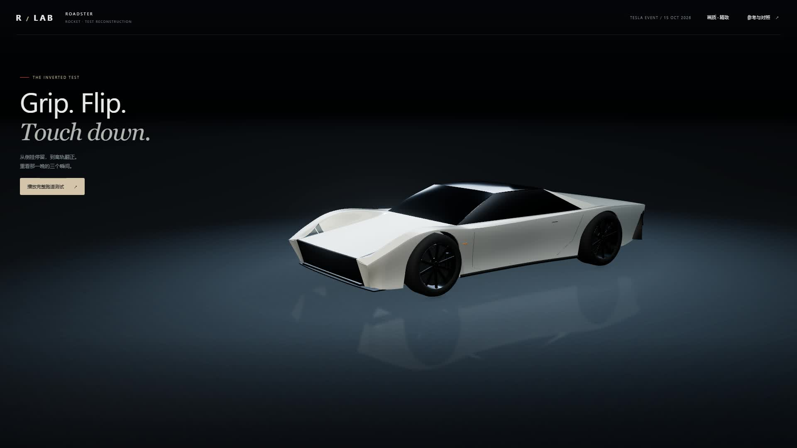
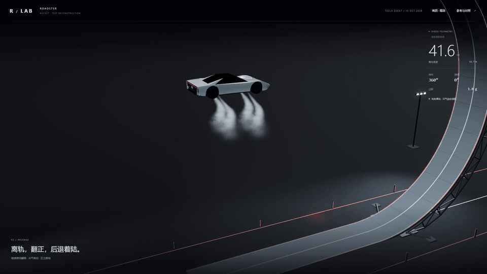
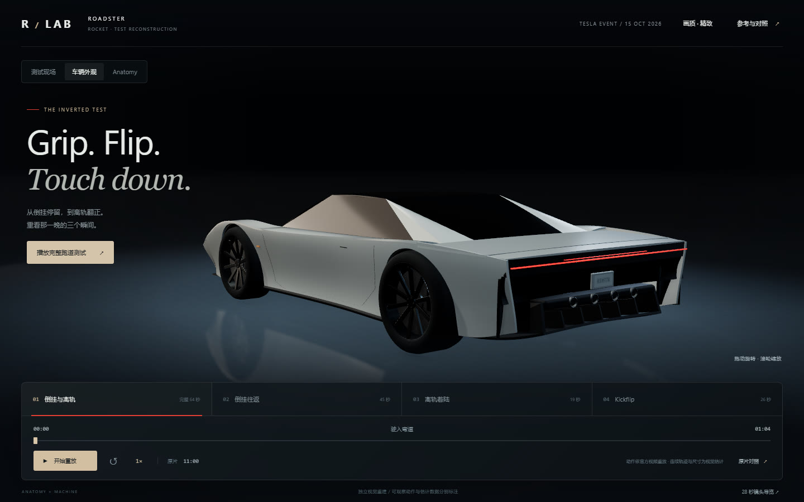
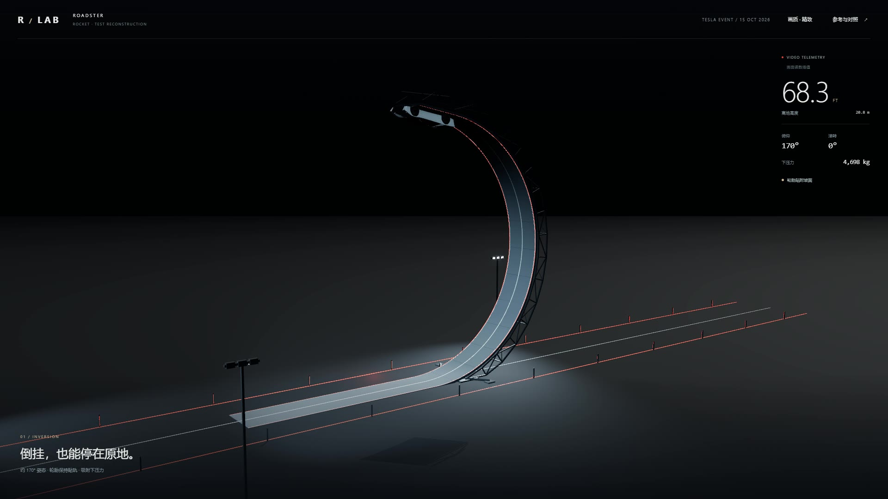
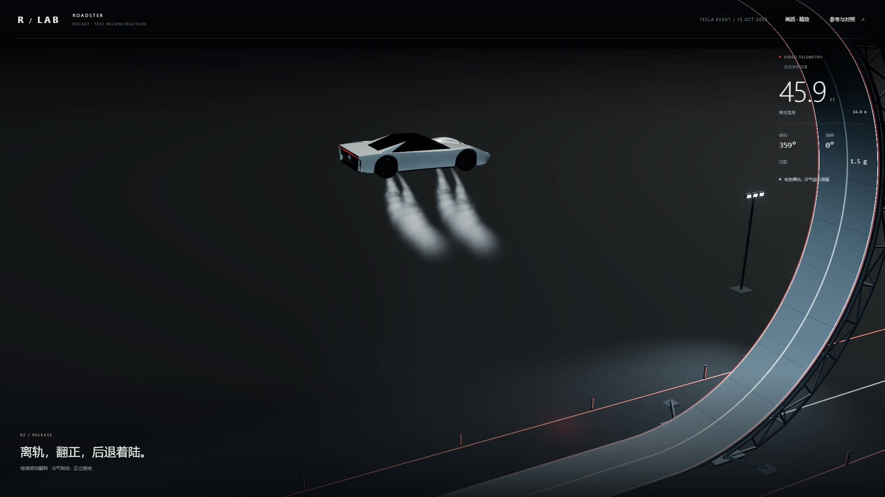
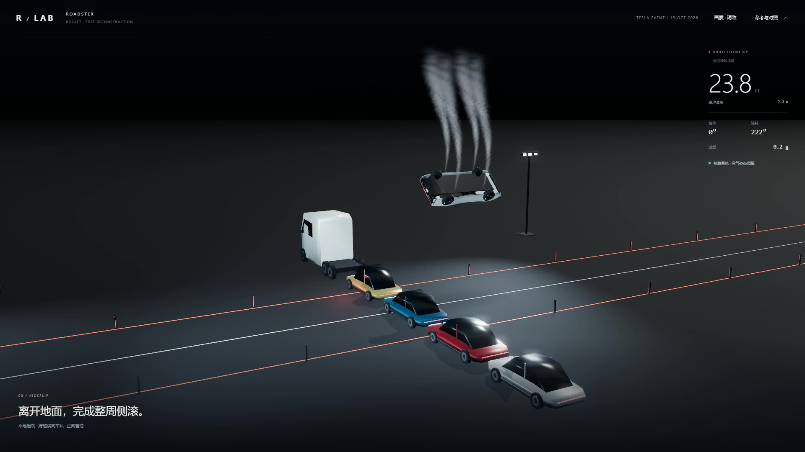

# Roadster Replay Lab

**Grip. Flip. Touch down.** 用 Three.js / WebGPU 重建倒挂跑道、离轨着陆与 Kickflip。

[](https://seekingy.github.io/roadster-flight-lab/)

### ▶ [观看完整 28 秒 Demo 影片 · 1080p](https://seekingy.github.io/roadster-flight-lab/roadster-film.mp4)

**[亲自操控 Demo](https://seekingy.github.io/roadster-flight-lab/)** · [WebGPU 重放](https://seekingy.github.io/roadster-flight-lab/webgpu-probe-roadster.html?mode=full) · [画质前后对照](https://seekingy.github.io/roadster-flight-lab/quality-comparison.html) · [下载 MP4](roadster-film.mp4)

[](https://seekingy.github.io/roadster-flight-lab/roadster-film.mp4)

*8 秒循环预览，截自本项目实际渲染的 28 秒影片（18–26 秒）；不是 Tesla 原片。 / An 8-second excerpt from this demo's rendered film, not Tesla footage.*

| 车辆外观 / Exterior | 倒挂停留 / Inverted ramp |
| --- | --- |
| [](media/exterior.jpg) | [](media/inverted.jpg) |
| **离轨与冷气制动 / Airborne landing** | **跨越车队侧滚 / Kickflip** |
| [](media/airborne.jpg) | [](media/kickflip.jpg) |

上图与动图均来自本项目 Demo。可暂停、慢放、拖动时间线、自由观察，并切换 Anatomy 分解。非官方视觉重建，尺寸和连续轨迹含估计。

---

公开测试影像的交互式视觉重建。基于 Tesla 官方 Roadster Event，使用 Three.js 重建车辆外观、倒挂跑道、离轨着陆与独立 Kickflip；另附 WebGPU / WebGL2 实验入口和 Anatomy 分解视图。

An unofficial interactive visual reconstruction of public Tesla Roadster test footage, built with Three.js. Includes the inverted ramp sequence, airborne landing, a separate kickflip, an Anatomy view, and an experimental WebGPU / WebGL2 renderer.

**本项目与 Tesla 无隶属或授权关系。尺寸、连续轨迹、镜头与喷流含视觉估计；它不是官方 CAD、数字孪生、真实飞行动力学预测或 100% 精度复现。**

**Not affiliated with or endorsed by Tesla. Dimensions, continuous motion, cameras, and vapor effects include visual estimates. This is not official CAD, a digital twin, or a validated flight simulation.**

## 运行 / Run

- 主 Demo：[roadster.html](roadster.html)。已内联打包，可直接用现代浏览器打开；需要 WebGL。原片对照与外部链接需要联网。
- WebGPU 实验：[webgpu-probe-roadster.html](webgpu-probe-roadster.html)。已打包依赖，通过本地服务器或 HTTPS 打开；不支持 WebGPU 时自动回退 WebGL2，界面显示实际后端。
- 画质滑块：[quality-comparison.html](quality-comparison.html)。
- 28 秒镜头导览：[roadster-film.mp4](roadster-film.mp4)。该剪辑浓缩主要动作，不等于测试的完整时长。

The main demo is self-contained and runs locally in a modern WebGL browser. The experimental WebGPU page is bundled and requires a local server or HTTPS; it automatically falls back to WebGL2. Online source playback requires an internet connection.

```sh
npm install
npm run build
npm test
npm run serve
```

在服务器给出的地址打开 `roadster.html` 或 `webgpu-probe-roadster.html`。也可使用系统自带的静态服务器代替 `http-server`。`npm run build` 生成可独立运行的 `roadster.html`。

Open either page at the address printed by the static server. Any equivalent static server works. The build generates the self-contained main demo.

## 操作与内容 / Controls and sequences

播放、暂停、拖动时间线、1× / 0.5× / 0.25×慢放、导演镜头 / 全景 / 跟车 / 自由观察、精致 / 流畅画质，以及 Anatomy 分解。

Play, pause, scrub, slow down, change camera or quality, and inspect the shared model in Anatomy mode.

| 片段 / Sequence | 时长 / Duration | 官方视频 / Source window |
| --- | --- | --- |
| 倒挂往返与离轨着陆 / Full ramp replay | 64 s | 11:00–12:04 |
| 倒挂往返 / Inverted ramp | 45 s | 11:00–11:45 |
| 离轨着陆 / Airborne landing | 19 s | 11:45–12:04 |
| 独立侧滚 / Kickflip | 26 s | 15:35–16:01 |

主 Demo 使用 Three.js WebGL 与 PBR 材质、环境反射、环境遮蔽、轻量 Bloom、柔化反射和白气粒子。WebGPU 页面共享模型与轨迹，采用兼容两后端的材质和简化白雾；它尚未包含主 Demo 的完整后处理。Unity 仅完成环境与方案评估，尚未制作 Unity 版本。

The main renderer uses WebGL with PBR materials, environment reflections, ambient occlusion, light bloom, softened planar reflection, and vapor particles. The WebGPU experiment shares the model and motion but uses a simpler compatible effects pipeline. A Unity version has not been built.

## 来源与边界 / Sources and limitations

主要来源是 [Tesla 官方 Roadster Event](https://www.youtube.com/watch?v=qt5p-_tE8d0)。完整来源分类见 [SOURCES.md](SOURCES.md)。

高度、下压力和过载来自官方画面读数的抽样与插值，不是实时物理求解器输出。车辆、坡道、场地和喷口未获得官方 CAD 或完整尺寸标定。白气是视觉粒子效果，不是 CFD。检查覆盖轨迹一致性、关键动作、界面和本机图形后端，不能证明实车性能或跨设备性能排名。

Telemetry is sampled and interpolated from visible source-video readouts, not produced by a live physics solver. Geometry is estimated without official CAD or complete camera calibration. Vapor is a visual particle effect, not CFD. Checks verify replay consistency and page behavior, not real-world vehicle performance or a cross-device renderer ranking.

## 代码与许可 / Code and notices

主要源文件：`test-app.js`、`car-v2.js`、`test-sequence.js`、`test-environment.js`、`anatomy-view.js`、`premium-render.js`、`vapor-v3.js`。`test-sequence.test.mjs` 验证轨迹、接触、着陆方向、整周侧滚和读数插值；早期独立教学模型未纳入此发布包。

Three.js 及其 addons 使用 MIT 许可。`lab-kit.js` 来自 Machine Skill kit，使用 MIT 许可，版权归 Air Supply Technologies Inc.。公开分发须保留这些第三方许可全文。Tesla 名称、商标、原片和原片截图不因本仓库的代码许可而重新授权；原片通过官方链接或播放器引用。

Three.js and its addons are MIT-licensed. The Machine Skill runtime in `lab-kit.js` is MIT-licensed by Air Supply Technologies Inc.; retain both third-party license notices when redistributing. Tesla names, trademarks, original footage, and source screenshots are not relicensed by this project's code license. Refer to the original material through official links or playback.

## Third-party notices

See [THIRD_PARTY_NOTICES.md](THIRD_PARTY_NOTICES.md), [LICENSE-THREE.txt](LICENSE-THREE.txt), [LICENSE-MACHINE.txt](LICENSE-MACHINE.txt), and [LICENSE-ANATOMY.txt](LICENSE-ANATOMY.txt). Original project code has no additional license grant in this release.

## Browser verification

Install Playwright Chromium with `npx playwright install chromium`, then run `node test-qa.mjs`. The WebGPU check expects the local server on port 8767. Measurement details and limitations are in [ENGINE-EVALUATION.md](ENGINE-EVALUATION.md).
